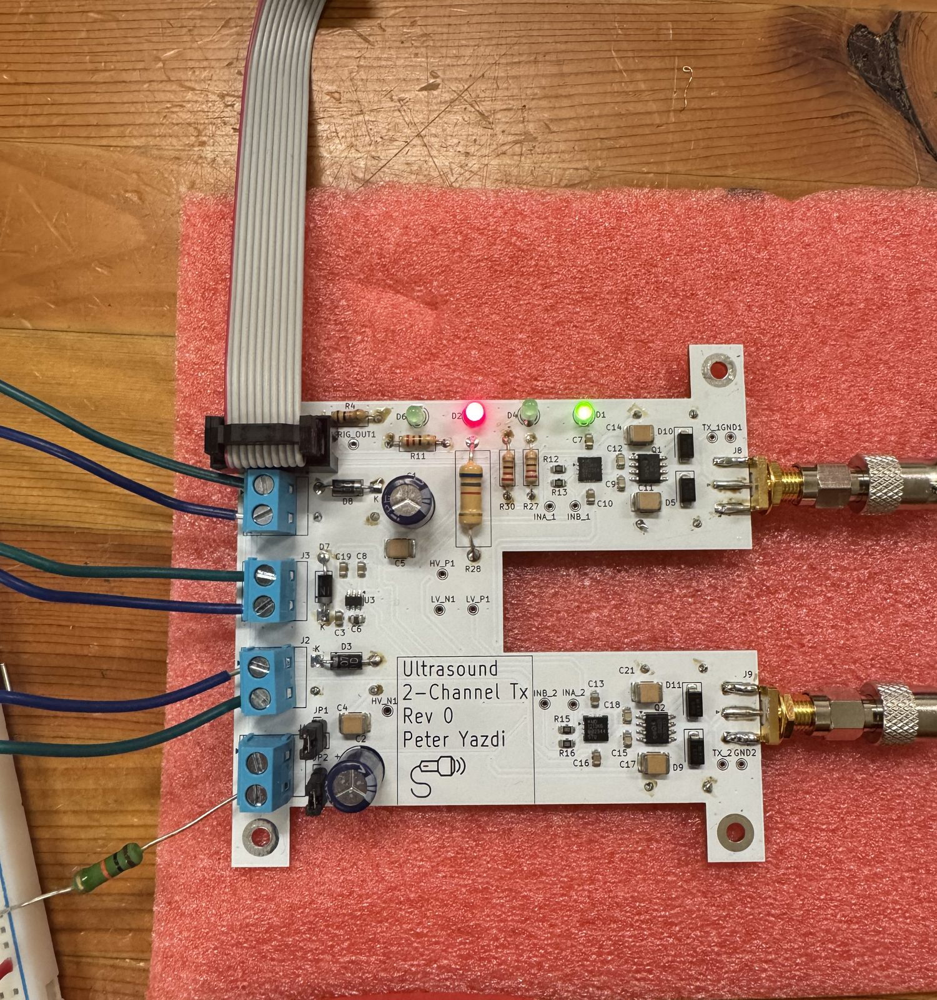
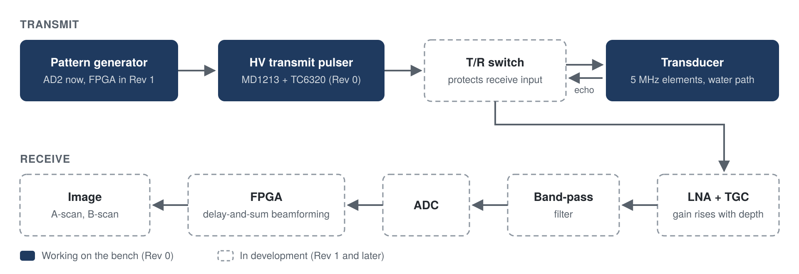

# Multi-Channel Ultrasound Imaging System

An ultrasound imaging system built from scratch: high-voltage transmit electronics, a receive chain, digitization and FPGA beamforming. Self-funded personal project.

<p align="center">
  
  <br>
  <sub>Rev 0 two-channel transmit pulser, powered on the bench.</sub>
</p>

## Status

| Stage | Scope | Status |
|---|---|---|
| Single-channel prototype | MSP430 board, custom PCB, 5 MHz piezo, envelope detection | Done |
| [Rev 0](rev0/README.md) | 2-channel high-voltage transmit pulser | Built, brought up, tested in water |
| [Rev 1](rev1/README.md) | 4-channel, 5 MHz transmit and receive: power module and Tx/Rx board | In design |
| Later | ADC capture on the FPGA, delay-and-sum beamforming, B-mode images of a phantom | Planned |

Each revision has its own page with the design, files and results.

<p align="center">
  
</p>

## Where it started

The project started as a single-channel system: an MSP430 board, a custom PCB and a 5 MHz piezo probe. Envelope detection kept the signal within the ADC's limits and was enough to tell skin from bone.

## Physics reference

| Quantity | Formula | Value at 5 MHz |
|---|---|---|
| Wavelength | λ = c / f | 0.308 mm |
| Axial resolution | c / (2f) per cycle | 0.154 mm |
| Depth from echo time | d = ct / 2 | 0.77 mm/µs |
| Max PRF | c / (2 × d_max) | 7700 Hz at 10 cm |
| Attenuation | ~0.5 dB/cm/MHz | 2.5 dB/cm |
| Sound speed (soft tissue) | | 1540 m/s |

## Repository layout

```
docs/images/   Photos, scope captures and block diagrams
rev0/          Rev 0 transmit pulser: KiCad project, fabrication files, test results
rev1/          Rev 1 power module and Tx/Rx board (in design)
```

## Getting the files

```bash
cd ~/Desktop
git clone https://github.com/peteryazdi/Medical_Imaging_Ultrasound_fromScratch.git
```

This works in Terminal on macOS and Linux and in PowerShell on Windows. Open the `.kicad_pro` files with KiCad 10.

## Safety

This is an educational project, not a certified medical device, and it is not intended for diagnostic or clinical use. The high-voltage circuits need appropriate safety practices. Acoustic output has not been characterized, so testing is done into water baths and phantoms.

## License

MIT. See [LICENSE](LICENSE).

## Author

Peter Yazdi, [peteryazdi@gmail.com](mailto:peteryazdi@gmail.com)
