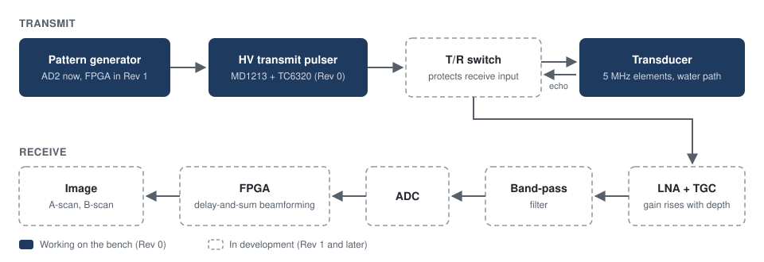
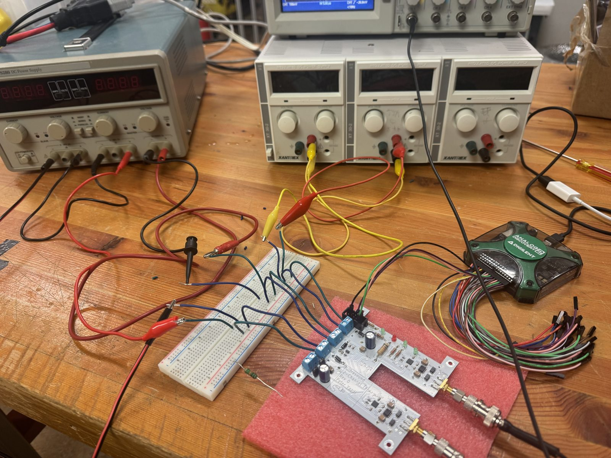
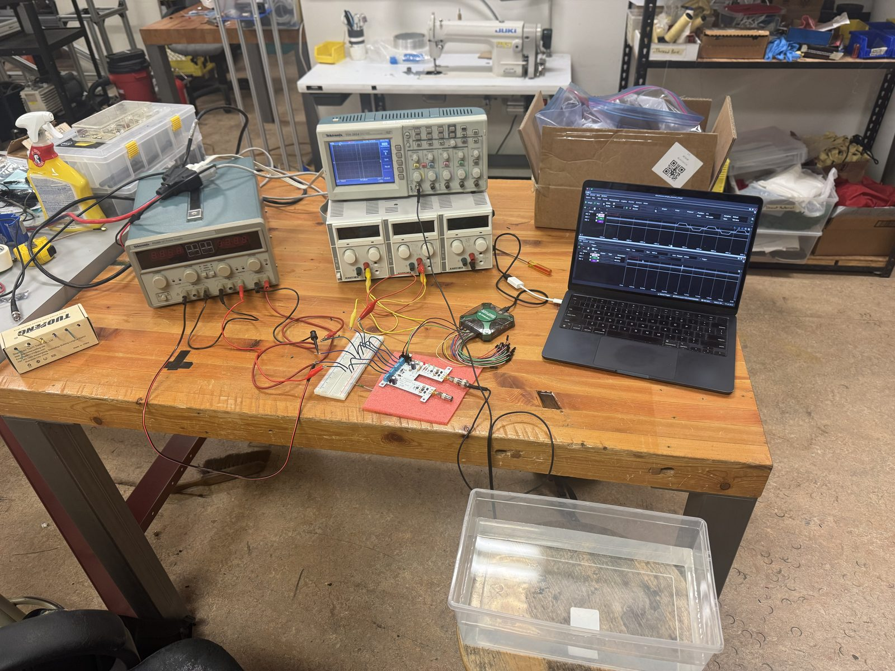
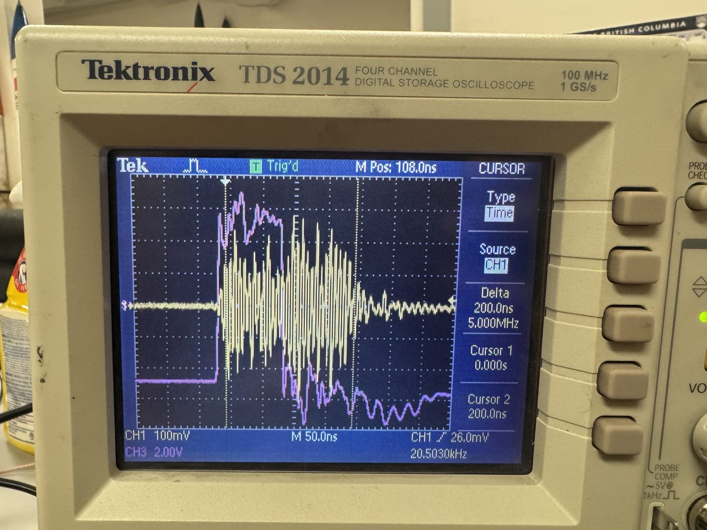
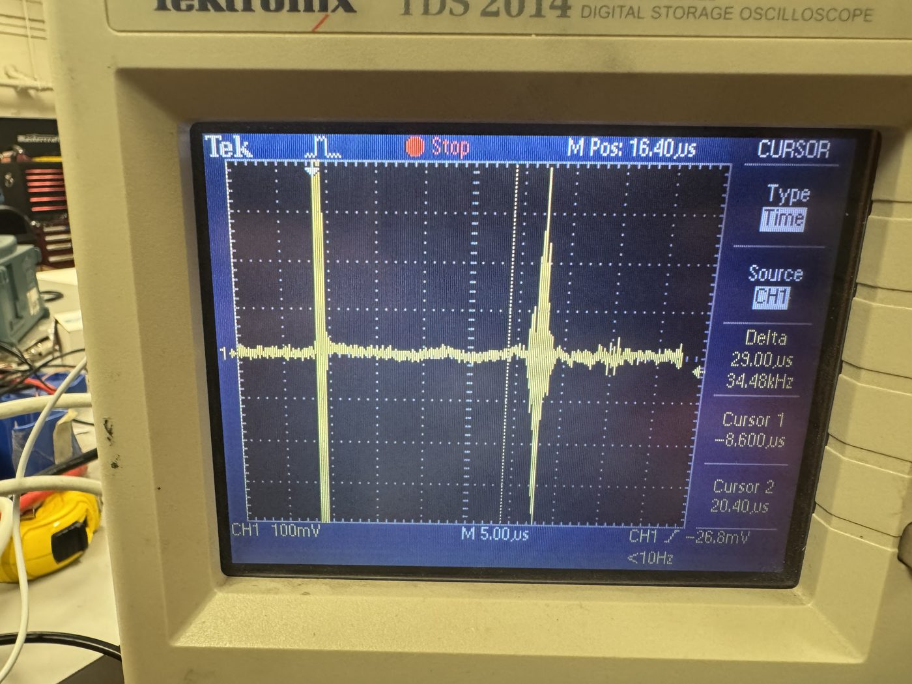

# Multi-Channel Ultrasound Imaging System

An ultrasound imaging system built from scratch: high-voltage transmit electronics, a receive chain, digitization and FPGA beamforming. Self-funded personal project.

<p align="center">
  
  <br>
  <sub>Rev 0 two-channel transmit pulser, powered on the bench.</sub>
</p>

## Status

| Stage | Scope | Status |
|---|---|---|
| Single-channel prototype | MSP430 board, custom PCB, 5 MHz piezo, envelope detection | Done |
| Rev 0 | 2-channel high-voltage transmit pulser | Built, brought up, tested in water |
| Rev 1 | 8-channel, 10 MHz transmit and receive system | Under development |
| Later | FPGA delay-and-sum beamforming, B-mode images of a phantom | Planned |

<p align="center">
  
</p>

## Rev 0: two-channel transmit pulser

Rev 0 is a 4-layer board that drives two transducers with bipolar high-voltage pulses. On each channel an MD1213 gate driver switches a TC6320 complementary MOSFET pair between the +HV and -HV rails. The gate drive is AC-coupled through 10 nF / 200 V capacitors, so the ±5 V driver outputs can control MOSFETs whose sources sit on the high-voltage rails. Back-to-back ES1D diodes clamp each transmit node, and each channel leaves the board on an SMA connector.

An LM2776 charge pump makes the negative driver rail from the single +5 V input. The HV rails have bulk and ceramic decoupling and 1 MΩ bleed resistors so they discharge when the supplies are off. The pulse inputs (INA, INB), output enable and trigger lines come in on a 2×5 header with 10 kΩ pull-downs, so the outputs stay off at power-up. HV nets are routed in their own net class with 0.5 mm clearance and 0.5 mm tracks.

The switching stage was simulated in LTspice before layout. The board was designed in KiCad and ordered from JLCPCB.

| Parameter | Value |
|---|---|
| Channels | 2 |
| Board | 4 layers, KiCad |
| HV rails | Designed for ±100 V, tested to ±60 V (limit of the bench supplies) |
| MOSFET pair | TC6320, 200 V |
| Gate drive | ±5 V, AC-coupled |
| Test pattern | 5 MHz, 60 ns per half-cycle with 40 ns dead time, 1 to 7 cycles, 1 kHz PRF |
| Measured frequency | 5.000 MHz (200 ns period) |

**Files**

- [Schematic (PDF)](rev0/PCB/rev0_Tx_Circuit.pdf)
- [KiCad project](rev0/PCB/)
- [Fabrication files: Gerbers, BOM, placement](rev0/PCB/jlcpcb/production_files/)
- [LTspice simulation](rev0/testing/LT_SPICE/tx_channel_sim.asc)
- [KiCad DRC and ERC reports](rev0/testing/KiCAD_software/)
- [Datasheets](rev0/datasheets/)

## Bring-up and test results

The board was brought up in four stages, each with an acceptance criterion that had to pass before moving on. The full write-ups are in the [bring-up procedure](rev0/testing/Rev0_TX_Pulser_Bring-Up_Procedure.pdf) and the [test report](rev0/testing/Rev0_TX_Pulser_Test_Report.pdf).

<p align="center">
  
  
  <br>
  <sub>Left: bench supplies, breadboard rail distribution, AD2 pattern generator and the board. Right: the full setup with the water tank.</sub>
</p>

1. **Unpowered checks.** Every reachable net checked for continuity and resistance against the layout. No solder faults, no rail-to-ground shorts.
2. **Power only.** HV rails walked up from 10 V with a 0.5 A current limit. The charge pump produced both driver rails, and with output enable held low both outputs stayed at 0 V at full rail voltage. Every later step depends on that interlock.
3. **First enable.** INA, INB and output enable from an AD2, verified on its logic analyzer before connecting. Clean bipolar switching into a 220 pF dummy load, with amplitude tracking the rail voltage.
4. **Water tank.** A second 5 MHz element used as an independent receiver. The received burst measures 200 ns per period (5.000 MHz). A target about 1 cm away returned an echo at 14 to 15 µs, consistent with the round trip at the speed of sound in water. Ring-down was 4 to 5 cycles with the transducer in air and close to none with its face in water.

<p align="center">
  
  
  <br>
  <sub>Left: received burst, cursors one period apart (200 ns, 5.000 MHz). Right: transmit feedthrough at t = 0 and the water-path echo 29 µs later.</sub>
</p>

**What didn't work, and why.** I could not resolve an interface below the front surface of a tissue target. The numbers rule out weak reflection and attenuation over a few millimetres. The real limits are on the receive side. The echoes are raw transducer output going straight into the scope, with no amplifier, filter or time-gain compensation, so millivolt returns sit near the noise floor. Transmit feedthrough and ring-down also blank the first few microseconds, which is exactly where a shallow interface returns. Raising the transmit voltage would scale the feedthrough along with the echo, so the next board is the receive chain rather than more drive.

**Open items**

- Switching times are not measured yet. The 100 MHz scope can't resolve edges faster than about 3.5 ns.
- Transducer capacitance is estimated at 220 pF and needs an impedance measurement.
- Dead time can't be safely reduced until a current-sense resistor on the HV rail can show shoot-through on the scope.
- The tests need a tissue-mimicking phantom with targets at known depths in place of hand-held targets.

## Rev 1 (under development)

An 8-channel, 10 MHz pulse-echo system split across custom boards: power, high-voltage pulse transmission, low-noise amplification with time-gain control, and an FPGA interface for delay-and-sum beamforming.

## Where it started

The project started as a single-channel system: an MSP430 board, a custom PCB and a 5 MHz piezo probe. Envelope detection kept the signal within the ADC's limits and was enough to tell skin from bone.

## Test equipment

- Tektronix TDS 2014 oscilloscope (100 MHz, 1 GS/s)
- Digilent Analog Discovery 2 as the pattern generator and logic analyzer
- Bench supplies, two 0 to 30 V units in series per HV rail plus a fixed 5 V unit
- 5 MHz thickness-gauge transducers with Lemo connectors, through SMA-to-Lemo adapters

## Physics reference

| Quantity | Formula | Value at 5 MHz |
|---|---|---|
| Wavelength | λ = c / f | 0.308 mm |
| Axial resolution | c / (2f) per cycle | 0.154 mm |
| Depth from echo time | d = ct / 2 | 0.77 mm/µs |
| Max PRF | c / (2 × d_max) | 7700 Hz at 10 cm |
| Attenuation | ~0.5 dB/cm/MHz | 2.5 dB/cm |
| Sound speed (soft tissue) | | 1540 m/s |

## Repository layout

```
docs/images/            Photos, scope captures and the block diagram
rev0/
  PCB/                  KiCad project and schematic PDF
    jlcpcb/             Gerbers, BOM and placement files sent for fabrication
  testing/              Bring-up procedure, test report, LTspice model, DRC/ERC reports
  datasheets/           Datasheets for the key parts
```

## Safety

This is an educational project, not a certified medical device, and it is not intended for diagnostic or clinical use. The high-voltage circuits need appropriate safety practices. Acoustic output has not been characterized, so testing is done into water baths and phantoms.

## Author

Peter Yazdi, [peteryazdi@gmail.com](mailto:peteryazdi@gmail.com)
