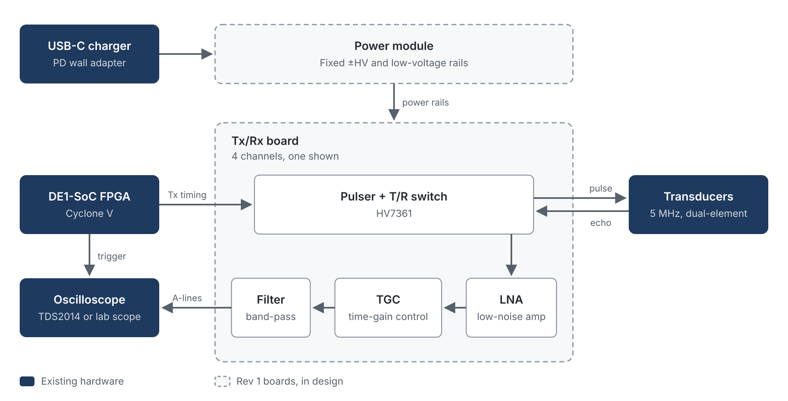

# Rev 1: four-channel transmit and receive

Rev 1 adds the receive chain that Rev 0 was missing. Each channel fires a transducer, then amplifies, gain-corrects and filters the echo so the A-line can be read on an oscilloscope. The DE1-SoC FPGA takes over pulse timing from the AD2 pattern generator used for Rev 0, and a USB-C power module replaces the bench supplies.

**Status:** in design.

<p align="center">
  
</p>

## Boards

| Board | What it does |
|---|---|
| Power module | Takes USB-C power and makes fixed ±HV rails and the low-voltage rails |
| Tx/Rx board | Four channels, each with an HV7361 pulser and T/R switch, a low-noise amplifier, time-gain control and a band-pass filter. Each channel has one BNC shared by transmit and receive. The outputs go to the oscilloscope, and a header connects to the DE1-SoC |

## Targets

| Parameter | Value |
|---|---|
| Channels | 4 |
| Centre frequency | 5 MHz |
| HV rails | Fixed, set to suit the HV7361 |
| Transducers | Two 5 MHz dual-element probes (4 elements) |
| Pulse timing | DE1-SoC (Cyclone V) |
| Receive output | Analog, read on the oscilloscope |

## Files

| Folder | Contents |
|---|---|
| `rev1/power/` | Power module KiCad project |
| `rev1/txrx/` | Tx/Rx board KiCad project |

## Results

In Progress.


## Getting the files

```bash
cd ~/Desktop
git clone https://github.com/peteryazdi/Ultrasound-Imaging-System.git
```

This works in Terminal on macOS and Linux and in PowerShell on Windows. Open the `.kicad_pro` files with KiCad 10.

## License

MIT. See [LICENSE](../LICENSE).
